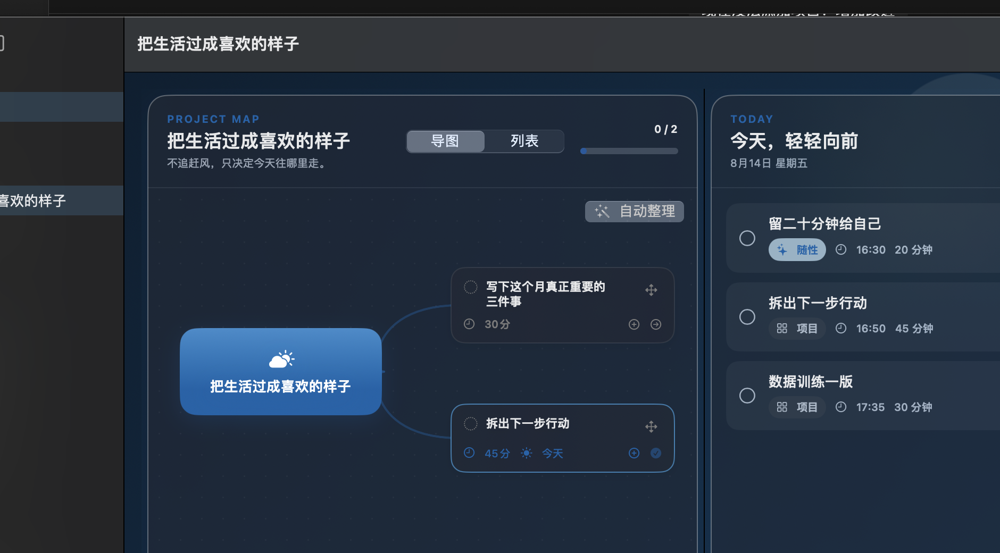
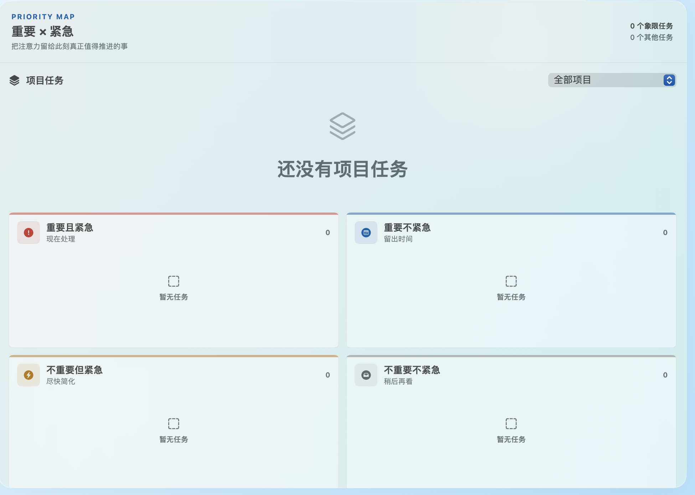
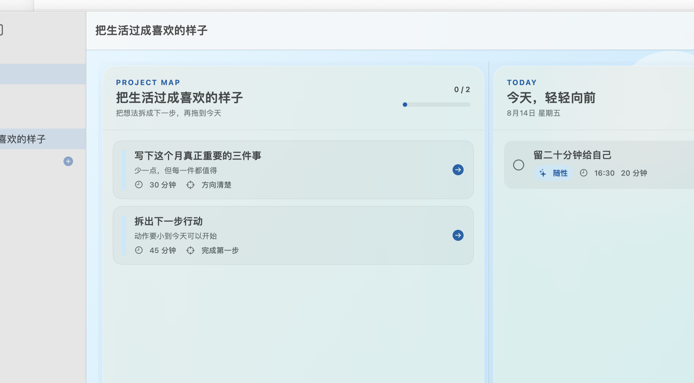

# 多项目管理以及注意力集中

一款轻量的原生 macOS 应用，帮助你同时管理多个任务，并看清每个任务现在应该推进到哪里、今天应该推进多少，从而更合理地分配时间与注意力。

English: [Multi-Project Management & Focus](docs/USER_GUIDE.en.md)

## 使用与版权

本仓库公开可见，允许个人学习、研究、运行和非商业修改；未经书面许可，不得商业使用、销售、公开再发布或移除版权声明。详见 [LICENSE.md](LICENSE.md)。公开仓库无法从技术上阻止复制；如果需要更强保护，应使用私有仓库。

## 它解决什么问题

当多个任务同时进行时，你需要知道三件事：每个任务当前处于什么阶段、今天应该为它投入多少、下一步从哪里开始。本应用把长期计划和今天的行动放在一起，帮助你在多个任务之间做出清晰而不过载的分配。

## 三个核心画面

### 1. 分项目的思维导图

每个项目都有自己的任务树和思维导图。你可以先看清一个项目的整体结构，再把其中今天真正能推进的一步放进今日安排。

### 2. 集体关注的四象限

把不同项目中的任务放到同一张重要/紧急四象限里比较。它关注的是当前全部任务的整体分配，而不是只盯着某一个项目。

### 3. 把今天要办的事情集中到一块

来自不同项目的行动、长期任务和临时想到的事情，都可以进入同一个“今天”列表。你可以统一排序、估算时间、完成任务，再回到各自项目继续推进。

## 使用

双击 `Build/云上计划.app`。如需重新生成应用，运行 `scripts/build-app.sh`。

AI 功能需要用户自己的 API Key；不填写时，其余功能完全离线可用。自定义服务必须兼容 Responses API。

从 Notion 导入时，先在 Notion 中导出 Markdown/CSV 并解压，然后在“AI 整理”中选择一个或多个导出文件。文件先在本机读取，点击“生成导入预览”后才会连同所选任务范围发送给当前 AI 服务；确认预览前不会修改工作区。

## 文档

- [中文应用手册](docs/USER_GUIDE.zh-CN.md)
- [English User Guide](docs/USER_GUIDE.en.md)
- [长期改版总结](需求记录.md)
